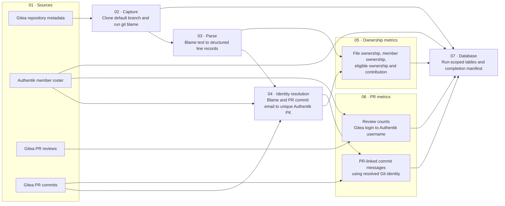

# Horizon feature tracks

The tracks below split Horizon into work a teammate can own from start to finish. Assign one owner per track, then follow its numbered features in order. Tracks can move in parallel once their listed inputs are available. The sequence is a dependency order, not an estimate; check off a feature only when its acceptance criteria in the detailed scope are met.

## Track 1 — Shared data contracts and identity

**Suggested owner:** Data contracts / platform engineer  
**Owner:** Yash

1. [ ] [Shared data contracts and source quality](#shared-data-contracts-and-source-quality)
2. [x] [People Portal roster and Git identity](#people-portal-roster-and-git-identity)

This track establishes the IDs, timestamps, and source conventions that the ingestion and signal tracks share.

## Track 2 — Gitea ingestion and engineering contribution

**Suggested owner:** Gitea / data pipeline engineer  
**Owner:** Yash

1. [x] [Gitea repository and blame capture](#gitea-repository-and-blame-capture)
2. [x] [Ownership calculations and engineering contribution](#ownership-calculations-and-engineering-contribution)
3. [x] [Gitea pull requests and reviews](#gitea-pull-requests-and-reviews)
4. [x] [PR-linked commit messages for SOW evidence](#pr-linked-commit-messages-for-sow-evidence)

**Needs:** Track 1 identity mapping for member attribution. PR-linked messages feed Track 5's SOW evidence workflow.

**Dagster stages:** `01_sources` reads repository metadata, the Authentik roster, PR reviews, and PR commits. `02_capture` clones and captures blame; `03_parse` turns raw blame into records; `04_identity` resolves blame and PR commit emails against the roster; `05_ownership` calculates file and member ownership; `06_pr_metrics` calculates review counts and PR-linked commit evidence; `07_database` sets up the feature schema and persists each output. Ownership and PR metrics are separate branches; only PR-linked commit evidence uses the shared identity result.

### How to read the Dagster lineage

In Dagster, start at **Lineage** for the overview. Expand one numbered group at a time: use `05_ownership` for blame-derived contribution or `06_pr_metrics` for review and PR evidence. Select an asset to inspect its description, latest materialization, row counts, and checks. Use **Runs** for step timing and logs when a stage fails. The extra links into `07_database` are run provenance and manifest checks; feature data still follows the source branches above.

**Dagster storage:** Persistence assets use the shared `PostgresResource` and `HORIZON_DATABASE_URL`; the local Horizon URL targets the codebase's Supabase Postgres database. Identity and feature assets return calculated data without opening database connections. The persistence layer depends on `feature_store_schema`, so schema setup happens once before writes. A live end-to-end run still needs an Authentik read token and a repository run configuration.

**Database access:** Upserts use each table's natural run/member/repository keys; the pipeline does not issue one `SELECT` per user. Roster email and username indexes are non-unique so duplicate identities can be counted and reviewed. Review snapshots are indexed both for member history and for run-wide reads.

## Track 3 — People Portal survey

**Suggested owner:** People Portal / survey engineer  
**Owner:** TBD

1. [ ] [Determine eligible respondent-to-tech-lead pairings](#survey-eligibility-and-assignments)
2. [ ] [Build the survey and capture responses](#survey-form-and-response-capture)
3. [ ] [Calculate collaboration metrics and response coverage](#survey-scoring-and-coverage)
4. [ ] [Publish the leadership signal for ranking](#survey-ranking-output)

**Needs:** Track 1 roster and project membership. The survey feeds Track 4's leadership signal.

## Track 4 — Member ranking

**Suggested owner:** Ranking / signals engineer  
**Owner:** TBD

1. [ ] [LLM signal generation and Postgres output](#llm-signal-generation-and-postgres-output)
2. [ ] [AppDev tenure signal](#appdev-tenure-signal)
3. [ ] [Leadership and responsibility signal](#leadership-and-responsibility-signal)
4. [ ] [Delivery against tasks and SOW signal](#delivery-against-tasks-and-sow-signal)
5. [ ] [Weighted ranking and persistence](#weighted-ranking-and-persistence)
6. [ ] [Ranking review and calibration](#ranking-review-and-calibration)

**Needs:** Track 1 membership data; Track 2 ownership/contribution outputs; Track 3 survey data. The SOW-based delivery dimension also needs Track 5's SOW API. Build each dimension as its evidence becomes available, then combine and calibrate the scores.

## Track 5 — Project health and SOW analysis

**Suggested owner:** Project health / signals engineer  
**Owner:** TBD

1. [ ] [Project health rubric and weights](#project-health-rubric-and-weights)
2. [ ] [People Portal SOW upload and API](#people-portal-sow-upload-and-api)
3. [ ] [LLM SOW workflow and pace tracking](#llm-sow-workflow-and-pace-tracking)
4. [ ] [Delivery and scope health](#delivery-and-scope-health)
5. [ ] [Engineering flow health](#engineering-flow-health)
6. [ ] [Quality and reliability health](#quality-and-reliability-health)
7. [ ] [Ownership and capacity health](#ownership-and-capacity-health)
8. [ ] [Blocker and risk trends](#blocker-and-risk-trends)
9. [ ] [LLM-generated SOW issue findings](#llm-generated-sow-issue-findings)

**Needs:** Track 2 PR and commit evidence and Track 4's persisted signal-output foundation. Put the SOW upload/API before the SOW workflow; the workflow supplies evidence to delivery, pace, and risk findings.

## Track 6 — APIs and product experience

**Suggested owner:** Full-stack / frontend engineer  
**Owner:** TBD

1. [ ] [Revamp the Horizon frontend](#revamp-the-horizon-frontend)
2. [ ] [Member ranking read APIs](#member-ranking-read-apis)
3. [ ] [Project health read APIs](#project-health-read-apis)
4. [ ] [Member ranking explorer](#member-ranking-explorer)
5. [ ] [Member profile and evidence detail](#member-profile-and-evidence-detail)
6. [ ] [Project health and audit workspace](#project-health-and-audit-workspace)
7. [ ] [Signal review and correction workflow](#signal-review-and-correction-workflow)
8. [ ] [Event talent discovery](#event-talent-discovery)
9. [ ] [TL/PL matching to a SOW](#tlpl-matching-to-a-sow)

**Needs:** Track 7 access rules before exposing data. Read APIs need persisted outputs from Tracks 4 and 5; page features follow their corresponding APIs. The frontend shell can be built while the APIs are in progress.

## Track 7 — Access, operations, and product discovery

**Suggested owner:** Platform / operations engineer  
**Owner:** TBD

1. [ ] [Access and data visibility controls](#access-and-data-visibility-controls)
2. [ ] [Run monitoring, retries, and backfills](#run-monitoring-retries-and-backfills)
3. [ ] [Weekly Dagster schedule](#weekly-dagster-schedule)

**Independent discovery item:**

- [ ] [Claude Skills use-case definition](#claude-skills-use-case-definition)

**Needs:** Put access rules in place before the APIs and website expose member or project evidence. Enable the weekly schedule after source and signal paths are reliable and monitoring is ready. Claude Skills scoping can proceed independently and does not block the core tracks.

## Detailed scope and acceptance criteria
### Track 1 — Shared data contracts and identity

#### Shared data contracts and source quality

- Define normalized IDs, timestamps, semester/reporting-period rules, source provenance, pagination, deduplication, incremental refresh, and backfill behavior.
- **Accept when** each ingested fact records its source and retrieval/update time, and Dagster checks detect stale, duplicate, or incomplete source data.

#### People Portal roster and Git identity

- Read the People Portal-managed roster from Authentik's onboarded-user directory filter, including each user's `pk`, username, email, name, active status, and retrieval time. Fetch every page; fail the source materialization if a page is missing or malformed.
- Use the Authentik user `pk` as Horizon's canonical member ID within the configured Authentik instance. It is not a universal cross-system ID and is not copied into Gitea.
- For Git blame, match the raw author email directly to an Authentik roster email only when there is one exact match. Retain the raw Git identity and leave missing or duplicate matches unresolved; do not guess from names or usernames.
- For Gitea pull requests and reviews, use the Authentik username to existing Gitea login crosswalk. People Portal's Gitea sync matches usernames to existing logins; it does not provision Gitea accounts.
- **Accept when** Horizon persists the roster snapshot, links only unique exact Git author emails to the canonical PK, and surfaces missing or ambiguous identities for review.

### Track 2 — Gitea ingestion and engineering contribution

#### Gitea repository and blame capture

- **Current code exists.** Fetch repository metadata, clone its default branch, capture Git blame, and parse the blame records.
- **Accept when** a Dagster run can produce the parsed records for a configured repository and reports capture/parse failures rather than silently succeeding with empty data.

#### Ownership calculations and engineering contribution

- **Current code exists for ownership calculations and eligible-source filtering.** Existing ownership assets retain raw Git identities; the new `eligible_file_ownership` and `engineering_contribution` assets aggregate exact, uniquely resolved email aliases under Authentik `pk` values. Their separate `07_database` assets write run-scoped rows.
- The engineering contribution outputs include eligible and non-boundary surviving source lines, repository shares, files owned, majority-owned files, surviving commits, and a `log1p` non-boundary line metric.
- These are deterministic inputs to ranking, not final ranking signals.
- Blame records only the name and email set in a member's local Git config. Resolve the author email directly to an Authentik roster email only when it is an exact, unique match; this Git-blame path does not go through Gitea login.
- Keep pull-request and review attribution on the Authentik username to Gitea login crosswalk from Track 1, because Gitea does not carry the Authentik `pk`.
- Leave unmatched or ambiguous Git identities separate with a null `authentik_user_pk`; persist their raw name/email and match evidence for review. Resolved rows also retain every raw alias in a JSONB audit field.

##### Engineering contribution signal

- Derive the engineering contribution signal from those ownership outputs.
- For each repository, calculate a member's share as their surviving eligible source lines divided by the repository's total surviving eligible source lines; retain per-repository shares so raw line totals from differently sized repositories are not compared directly.
- Use files owned and majority-owned files as supporting measures of breadth and concentration.
- Exclude generated files, vendored code, and lockfiles from eligible source lines.
- The LLM applies the versioned engineering-contribution rubric to these calculated metrics and returns a dimension score with evidence references and uncertainty; it must not count commits or lines itself or reward standalone commit volume.
- **Accept when** deterministic ownership metrics are reproducible from parsed blame, exclusions are applied consistently, and each generated score can be traced to the member's repository/file metrics.
- The deterministic ownership and eligible-source metrics are implemented in Dagster. LLM scoring with the versioned rubric remains planned.

#### Gitea pull requests and reviews

- **Implemented:** Paginated Gitea API ingestion reads all open and closed pull requests and their review pages. It checks Gitea's advertised counts and page links; it does not ingest standalone commit activity or add persisted review-event tables.
- For each member and Dagster run, write one deterministic snapshot row to a single Postgres table, `member_pr_review_counts`, with these columns: `member_id`, `dagster_run_id`, `created_at`, `reviews_written_count`, `approvals_given_count`, and `changes_requested_count`. `(member_id, dagster_run_id)` is the primary key; a reverse index supports run-wide reads.
- Count submitted reviews, reviews with the `APPROVED` decision, and reviews with the `REQUEST_CHANGES` decision, respectively.
- Treat the counts as cumulative totals observed by that run; `created_at` records when the snapshot was stored.
- Attribute each review using the reviewer's Gitea `login`, then resolve that login through the Track 1 crosswalk to the Authentik `pk`; retain unresolved reviewers for review rather than guessing.
- **Accept when** every counted review is attributed through a unique Gitea-login-to-Authentik-`pk` mapping, each member has at most one row per Dagster run, and repeated materializations do not create duplicate rows.
- This feature stores deterministic Gitea-derived counts only; it does not generate LLM scores, summaries, or evidence fields.

#### PR-linked commit messages for SOW evidence

- **Implemented:** For each PR, retrieve only the commits attached to that PR and make their messages available as evidence for SOW progress checks.
- Postgres table `horizon_gt_features.pr_linked_commit_messages` stores one row per linked commit with columns `organization`, `repository`, `pull_request_number`, `commit_sha`, `author_name`, `author_email`, `committed_at`, `message`, and `dagster_run_id` (the latest run that observed the record).
- Use `(organization, repository, pull_request_number, commit_sha)` as the key so repeated runs update the same record instead of duplicating it.
- Do not build a standalone repository-wide commit activity feed or score people by commit count.
- **Accept when** Horizon can trace every stored message to its PR, author, and source commit, and make it available as evidence for SOW progress analysis.

### Track 3 — People Portal survey

#### People Portal tech lead support and collaboration survey

##### Survey eligibility and assignments

- At the end of each semester, pair every eligible member in a project with **each tech lead in that same project**.
- Do not include a project lead unless that person is also a tech lead in the project.
- Scope each pairing to one semester, project, respondent, and rated tech lead.

- **Accept when** each eligible member has a survey pairing for every tech lead in their project, with no project-lead-only pairings.

##### Survey form and response capture

- Use this scale for every statement:

| Response | Meaning |
|---|---|
| 1 | Never |
| 2 | Rarely |
| 3 | Sometimes |
| 4 | Usually |
| 5 | Consistently |
| N/A | I did not interact enough with this tech lead, or this situation did not arise |

- Ask members to rate each statement beginning, **“During this semester, this tech lead…”**

1. Made the project's goals, priorities, and expectations clear.
2. Was reachable and responded in time when I needed their input.
3. Helped resolve a blocker or connected me with someone who could.
4. Gave feedback that was timely and specific enough for me to act on.
5. Planned work and deadlines realistically, and communicated changes.
6. Made space for my input and treated my contributions respectfully.
7. Followed through on decisions and commitments, or clearly updated us when plans changed.

- Collect one response for each respondent/project/semester/tech-lead pairing.
- Accept only the listed `1`–`5` values or `N/A`, and keep N/A distinct from an unanswered item.
- Prevent duplicate submissions for the same pairing and semester.

- **Accept when** eligible members can submit a survey for each assigned tech lead, and every saved response retains its respondent, project, semester, and rated tech lead.

##### Survey scoring and coverage

- For each project, semester, and tech lead, calculate each item's mean from its valid `1`–`5` responses, excluding N/A.
- The item means represent clarity, responsiveness, blocker support, actionable feedback, planning, inclusion, and follow-through.
- Include a valid respondent count for each item and suppress an item's mean when it has fewer than three respondents.

- Calculate the overall collaboration and support score as the unweighted mean of the available item means.
- Publish it only when at least three distinct members provided valid ratings on at least five of the seven items.
- Otherwise mark the result **insufficient responses**.
- Never treat N/A or insufficient coverage as a low score.

- **Accept when** item means, respondent counts, overall score out of 5, and the insufficient-response state follow these rules reproducibly.

##### Survey ranking output

- Expose the deterministic survey result for Track 4, scoped to project, semester, and tech lead.
- Include the per-item collaboration metrics and counts, overall score and respondent count when available, and coverage state.
- Keep this as a numeric peer-feedback signal; do not use an LLM to score survey answers.

- **Accept when** the ranking pipeline can consume the scoped output without losing its item-level metrics or response-coverage context.

### Track 4 — Member ranking

#### LLM signal generation and Postgres output

- Use the normalized Dagster source and feature outputs to assemble relevant evidence in memory for each member and semester or each project and reporting period.
- This evidence assembly is an internal pipeline step, not a separate persisted semester snapshot feature.
- Give each LLM only evidence relevant to the target and period, plus the applicable versioned rubric.

- For member ranking, generate structured per-dimension scores, concise rationales, source evidence references, coverage, uncertainty, and missing-data flags.
- For project health, generate structured dimension assessments and an overall status/score only when the rubric defines one; include explanations, source evidence references, coverage, uncertainty, and missing-data flags.
- SOW breakdowns and PR evidence matches remain suggestions and can supply project-health evidence, but must not be treated as confirmed completion.

- Persist the generated member and project signals in a dedicated Postgres signal-output table, separate from the ingested source and deterministic feature tables.
- Scope each output to its member or project, semester/reporting period, signal type, and Dagster `run_id`; retain evidence references and the rubric/model versions so results can be traced and compared across runs.
- FastAPI reads these persisted outputs rather than invoking an LLM for each request.
- The table schema is part of later implementation; this feature-plan change does not create it.
- **Accept when** outputs validate against their schemas, factual claims link to ingested evidence, run history is queryable, and missing or weak evidence is represented as uncertainty rather than an invented score.

#### AppDev tenure signal

- Derive tenure from People Portal membership dates and apply the agreed capped mapping to a 0–100 dimension score.
- **Accept when** tenure is measured as of the semester and cannot dominate the ranking beyond its 5% weight.

#### Leadership and responsibility signal

- Use the numeric tech lead support and collaboration survey as peer feedback for members serving as tech leads.
- Keep results scoped to each project and semester, with the overall score, per-item collaboration metrics, response counts, and coverage state available to the ranking pipeline.
- Do not infer a low score from insufficient responses or N/A answers.
- **Accept when** the leadership signal can consume the deterministic survey output and retain its project, semester, and response-coverage context.

#### Delivery against tasks and SOW signal

- Combine assigned task completion/timeliness with SOW deliverables and linked Gitea changes.
- Account for approved scope changes and uncertain task-to-code links.
- **Accept when** the signal distinguishes completed, late, blocked, reassigned, and unverified work.

#### Pilot ranking weights by role

The supplied weights draft describes pilot rubrics, not an approved production policy. For each member, role, project, and semester, calculate the available metrics, convert them to percentiles in the role's comparison group, combine metrics into bucket scores using the metric shares below, then combine bucket scores using the role's bucket weights. Reverse the percentile for lower-is-better measures such as end loading. Keep missing metrics out of the score and report coverage; do not treat missing evidence as zero.

| Role | Bucket weights in the draft overview | Comparison group in the draft |
|---|---|---|
| Engineer | Code ownership 30%; delivery vs. SOW 20%; consistency 15%; review and collaboration 15%; peer ratings 10%; club engagement 10% | Members of the engineer's own project team |
| Tech lead | Team delivery vs. SOW 30%; review and unblocking 25%; leadership ratings 25%; team consistency 10%; own code 5%; club engagement 5% | All tech leads in the club |
| UI/UX designer | Peer ratings 40%; design delivery vs. SOW 35%; consistency 15%; club engagement 10% | All UI/UX designers in the club |
| PM / project lead | Survey ratings 90%; club engagement 10% | Not defined |

The engineer overview conflicts with its detailed sections: the detailed code ownership bucket is 35% and review/collaboration is 10%, while the overview says 30% and 15%. Both versions total 100%; resolve which pair is intended before producing an engineer ranking. The draft also says to average metrics within a bucket while assigning different metric shares, so use the listed shares as weights only after confirming that interpretation. PM/project-lead scoring is explicitly provisional: the draft supplies no survey metric split, comparison group, or scoring rule.

**Engineer metric shares:** Code ownership uses files majority-owned (40%), non-boundary surviving code lines on a log scale (35%), and surviving commits with living lines (25%); mean file share is listed at 0% and is excluded. Delivery uses verified SOW completion (70%; done = 1, partial = 0.5, not done = 0) and on-time completion (30%). Consistency uses active-week ratio (50%), surviving lines authored in the final three weeks (30%, inverted), and weekly-report regularity (20%). Review/collaboration uses teammate PRs reviewed (40%), median review turnaround (30%), and collaborative PRs with multiple contributors or `Co-authored-by` trailers (30%). Peer ratings split evenly across timeliness, proactiveness, design contribution, and collaboration. Club engagement uses event attendance (60%) and AppDev tenure (40%).

**Tech lead metric shares:** Team delivery uses verified team SOW completion (70%) and team on-time rate (30%). Review/unblocking uses team PRs reviewed (35%), median review turnaround (35%), and review spread across team engineers (30%). Leadership ratings split evenly across proactiveness, design contribution, stakeholder participation, and guidance. Team consistency uses weekly-report regularity (60%) and the team's surviving lines authored in the final three weeks (40%, inverted). Own code uses majority-owned files (50%) and non-boundary surviving code lines (50%, log-scaled). Club engagement uses event attendance (60%) and tenure (40%).

**UI/UX metric shares:** Peer ratings use buildability (30%), feedback responsiveness (30%), proactiveness (20%), and stakeholder participation (20%). Design delivery uses verified SOW design completion (70%) and on-time delivery (30%). Consistency uses active weeks with Figma edits (60%) and edits in the final three weeks (40%, inverted). Club engagement uses event attendance (60%) and tenure (40%). This rubric depends on Horizon having access to a shared club Figma team; validate that Figma version history can attribute edits to individual designers before relying on these metrics.

**PM / project-lead draft:** The only specified buckets are survey ratings (90%) and club engagement (10%). The survey questions, metric shares, comparison group, and any objective work-history signals remain undecided. Google Docs history and Slack activity are listed only as ideas for future investigation, not approved scoring inputs.

The Git-blame metrics in these rubrics need a consistent cleaning pass using `git blame -w -M -C` and a way to exclude formatting-only changes, so whitespace edits and moved code are not counted as new authorship. Blame measures only lines still present at the end of the period; it misses deleted work, reviews, and work on non-default branches. Treat blame-based scores as one evidence source with that survivorship limitation.

These weights define the ranking layer over Dagster's ingested source and deterministic feature outputs; they do not mean every listed metric is already available in the pipeline. Gitea review and issue/milestone data, People Portal survey and engagement data, weekly reports, SOW evidence, and Figma history have separate source work in the tracks above. Keep unsupported dimensions missing with coverage details until their source and calculation are implemented.

#### Weighted ranking and persistence

- Select the approved role rubric for the member and reporting period, then combine its metric and bucket scores into the overall ranking. Do not publish engineer scores until the conflicting code-ownership and review weights are resolved; do not treat the incomplete PM/project-lead outline as a production rubric.
- Persist the overall score/rank with coverage, semester, Dagster `run_id`, and weight version in the signal-output store, linked to its component signals.
- Store the role, comparison-group definition, metric/bucket weights, and rubric version with each result. Confirm each production rubric totals 100% at both the metric and bucket levels.
- Missing dimensions are not zeros; expose coverage and avoid comparing scores with materially different evidence coverage as if equivalent.

#### Ranking review and calibration

- Provide a reviewer process to examine sample member evidence and scores, record disagreements, and tune rubric versions through an auditable change.
- **Accept when** a pilot can compare generated results with reviewer assessments and report score/rank changes across rubric versions.

### Track 5 — Project health and SOW analysis

#### Project health rubric and weights

- Agree on project health dimensions, evidence rules, directionality, and weights before producing a combined score.
- Candidate dimensions are delivery/scope, engineering flow, quality/reliability, ownership/capacity, and blocker/risk trends.
- **Accept when** the rubric is versioned and each dimension has a defined evidence set and missing-data rule.

#### People Portal SOW upload and API

- Let authorized project members upload one SOW document for their project at the beginning of each semester (initially PDF and DOCX, subject to People Portal's supported formats).
- Capture project, semester, uploader, upload time, and file type.
- Keep one document per project and semester; no version history or replacement workflow.
- Expose the authorized SOW and its metadata or extracted text through the People Portal API, including stable SOW/project IDs and semester, while enforcing project access rules.
- Add a Dagster source asset that retrieves this SOW and records its ID, project, semester, and retrieval time; repeated materializations must be idempotent.
- **Accept when** the project team can upload and view the semester's SOW, Horizon can retrieve that same document through the API, and Dagster runs neither duplicate it nor lose its People Portal source reference.

#### LLM SOW workflow and pace tracking

##### SOW breakdown and PR evidence suggestions

- Use an LLM to read the project's single semester SOW, extract its scope, deliverables, milestones, acceptance criteria, owners, and dates, then suggest weekly progress checks.
- Each suggested check should include a target week/date, task or outcome, acceptance evidence, dependencies, responsible team/member when supported, and a reference to the exact SOW section/page.
- Use the project timeline when provided; flag missing dates or ambiguous requirements instead of inventing them.
- For each suggested check, use relevant Gitea PR titles, descriptions, states, merge status, and linked commit messages to suggest matching evidence.
- Return supported, uncertain, and unmatched evidence separately, with match confidence and links to the exact PR/message and SOW check.
- These are suggestions: no approval step is required, and a PR or commit message alone must not mark a check complete.
- **Accept when** the extracted plan, suggested weekly checks, and proposed evidence matches are returned in a validated structured format and every check and match is traceable to its source SOW or PR evidence.

##### Project pace assessment

- Compare LLM-suggested weekly checks and their target dates with linked Gitea evidence.
- Show date state and evidence state separately: upcoming or past due, and supported, uncertain, or no matching PR evidence.
- A PR match is not proof of completion, and no match is insufficient evidence rather than proof of delay.
- **Accept when** each status is reproducible for a reporting date and its rationale links to the SOW check and exact PR evidence, when available.

#### Delivery and scope health

- Compare LLM-suggested SOW weekly checks with target dates and PR-linked commit-message evidence.
- **Accept when** project status shows upcoming or past-due checks and distinguishes supported, uncertain, and missing evidence without treating a PR message as proof of completion.

#### Engineering flow health

- Use PR age/review cycle, merge cadence, and work-in-progress where available.
- **Accept when** measures are reported as trends and interpreted against project context rather than using one universal threshold without validation.

#### Quality and reliability health

- Use Gitea PR review outcomes, such as approvals and requested changes, as review-process indicators.
- Do not present these as build, production-quality, or incident-reliability measurements; those remain unavailable without dedicated sources.
- **Accept when** review trends link to PR/review evidence and unsupported reliability claims are omitted.

#### Ownership and capacity health

- Combine project roster and assignments with Gitea ownership/concentration measures.
- **Accept when** the signal can flag unowned work or high concentration and accounts for project size and team availability where data exists.

#### Blocker and risk trends

- Aggregate SOW pace findings and linked PR evidence to highlight upcoming or past-due checks and uncertain or missing evidence.
- Treat these as progress risks or evidence gaps, not confirmed defects or blockers.
- **Accept when** each finding links to its SOW check and PR evidence, when available, and its evidence state is explicit.

#### LLM-generated SOW issue findings

- Compare SOW commitments and LLM-suggested weekly checks with commit messages linked to Gitea pull requests.
- Have the LLM propose Horizon-only findings such as a potentially missed checkpoint, delivery risk, scope mismatch, or insufficient evidence; do not ingest, create, or assign Gitea issues.
- Store findings in a separate planned table, `horizon_gt_features.sow_llm_issues`, with project/SOW/checkpoint references, finding type and summary, supporting PR/commit references, the Dagster run ID, creation time, and review status.
- **Accept when** each finding is traceable to a SOW checkpoint and supporting source evidence, missing evidence is identified as uncertainty rather than proof of failure, and reviewers can accept or dismiss findings without changing Gitea.

### Track 6 — APIs and product experience

#### Revamp the Horizon frontend

- Rebuild the Horizon website inside the TechOps monorepo, replacing the prototype frontend from `project-health-intelligence-mock`.
- Use the same stack as the People Portal web UI (React, TypeScript, Vite, Tailwind, React Query and React Router) as an Nx project, so the team works in one setup.
- Provide the app shell the other website features live in: navigation between member ranking and project health, Authentik sign-in, shared layout, tables and charts, and loading, empty, error and stale-data states.
- The frontend reads only from the Horizon read APIs; it never queries Supabase or calls an LLM directly.
- Use the prototype for layout ideas only, not its code.
- **Accept when** the app builds and runs as an Nx project, users sign in through Authentik, every page reads from the read APIs, and the other website features can be added as pages without changing the shell.

#### Member ranking read APIs

- Add FastAPI endpoints to list rankings by semester and retrieve a member's component scores, coverage, evidence references, and history.
- **Accept when** responses are paginated/filterable and do not expose fields to unauthorized users.

#### Project health read APIs

- Add FastAPI endpoints to list project health by reporting period and retrieve a project's component signals, evidence, and trend history.
- **Accept when** clients can distinguish current, stale, provisional, and missing results.

#### Member ranking explorer

- Build a website view with semester selection, ranked member list, dimension breakdown, and filters supported by available data.
- **Accept when** a user can navigate from an overall score to the evidence behind each dimension.

#### Member profile and evidence detail

- Show the member's semester history, component scores, evidence coverage, and linked source records.
- **Accept when** each score explanation can be inspected without presenting an LLM summary as raw source data.

#### Project health and audit workspace

- Show project health status and history, delivery against milestones, engineering flow, quality, ownership, blockers, and source evidence.
- **Accept when** a reviewer can move from a project-level signal to its underlying evidence and prior reporting periods.

#### Signal review and correction workflow

- Let authorized reviewers flag incorrect identity links, source facts, or LLM assessments; record reviewer, reason, timestamp, and resolution.
- **Accept when** corrections are auditable and a later pipeline run can incorporate approved corrections without erasing the original output.

#### Event talent discovery

- Allow an authorized organizer to describe event needs and filter eligible members using available ranking dimensions.
- Show why each person is suggested and let the organizer build/review a shortlist.
- **Accept when** eligibility is enforced and recommendations are traceable to evidence.

#### TL/PL matching to a SOW

- Extract project requirements and responsibilities from a SOW, then recommend technical/project leads using relevant skills, delivery, leadership, and availability data where available.
- Show fit, gaps, and evidence for each candidate.
- **Accept when** a user can compare candidates and edit the extracted requirements before relying on the match.

### Track 7 — Access, operations, and product discovery

#### Access and data visibility controls

- Define roles for members, project leads, reviewers, and administrators.
- Restrict questionnaire, experience, and ranking evidence according to the approved access policy.
- **Accept when** API and website enforce the same permissions and access decisions are auditable.

#### Run monitoring, retries, and backfills

- Expose run status, source freshness, failures, and signal publication status; retry transient source errors and support targeted historical backfills.
- **Accept when** a failed source does not publish a misleading partial ranking/health result and operators can rerun the affected period safely.

#### Weekly Dagster schedule

- Configure the production pipeline to run once a week after source and signal paths are reliable.
- **Accept when** the deployed scheduler's behavior is verified across month boundaries and each run has a distinct traceable ID.

#### Claude Skills use-case definition

- The scoping notes mention Claude Skills but do not define a Horizon behavior.
- Clarify the target user, input/output, and connection to ranking, matching, or project auditing before adding implementation work.
- **Accept when** the product use case and an initial acceptance test are agreed.
